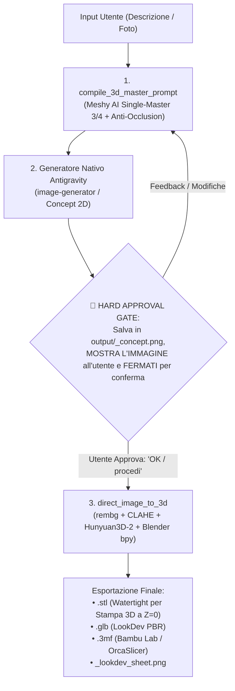

# Production Neural 3D Architecture & Operational Protocol
### Antigravity Native 2D Concept + Local3D Studio 3D Pipeline (Hunyuan3D-2 + Blender bpy)

Questo documento definisce il protocollo operativo standard per l'agente AI nella generazione e manifattura 3D di asset fisici (statuette, miniature, parti meccaniche) e digitali.

---

## 🏛️ Architettura di Sistema a 3 Passi

---

## 📋 Protocollo Operativo Rigido (3 FASI)

### Fase 1: Compilazione del Master Prompt (`compile_3d_master_prompt`)
1. Chiama il tool MCP `compile_3d_master_prompt(subject=..., art_style=..., add_pedestal_base=False)`:
   - **Inquadratura**: Singolo soggetto a figura intera, vista isometrica a 3/4 (35 gradi) che mostri chiaramente sia il fronte che la profondità laterale/posteriore.
   - **Anti-Occlusione Totale**: Tutti gli arti separati (A-pose aperta per umanoidi, 4 zampe ben distanziate per quadrupedi, ali sollevate e staccate, coda con radice visibile e mai sovrapposta ai piedi).
   - **Zero Effetti / Zero Fumo / Zero Basetta**: Rigorosamente vietati aure energetiche, fulmini, fumo, fiamme, nuvole, basi/piedistalli circolari (a meno che `add_pedestal_base=True`). Solo il corpo solido del soggetto!
   - **Colori e Rilievo 3D**: Separazione cromatica netta, profonda *Ambient Occlusion* nei solchi tra arti in primo piano e arti in secondo piano, dettagli scolpiti con rilievo fisico su sfondo bianco puro `#ffffff`.

### Fase 2: Generazione Nativa 2D e Blocco di Approvazione
1. Usa il generatore di immagini nativo di Antigravity (subagent `image-generator`) passando il `compiled_prompt`.
2. Salva l'immagine generata in `output/<nome>_concept.png`.
3. Mostra l'immagine generata all'utente nel messaggio di chat.
4. **STOP FISICO ASSOLUTO**: Fermati tassativamente e attendi l'esplicita conferma dell'utente ("OK", "confermo", "procedi").
   - **REGOLA FERREA**: È SEVERAMENTE VIETATO chiamare strumenti 3D (`direct_image_to_3d` o altri) nello stesso turno della generazione 2D!

### Fase 3: Ricostruzione Neurale 3D (`direct_image_to_3d`)
Una volta ricevuta l'approvazione dell'utente (o quando l'utente fornisce direttamente un'immagine 2D), chiama `direct_image_to_3d(image_path=...)`:
1. **Calibrazione Automatica**:
   - Rimozione sfondo con `rembg_engine.py` + filtro componente connesso maggiore (rimozione di qualsiasi frammento o detrito volante).
   - Contrasto locale CLAHE + centramento e ground lock a $Z=0$ ($Y=456$) su canvas bianco puro `#ffffff`.
2. **Ricostruzione Neurale**:
   - Esecuzione isolata di `Hunyuan3D-2` con `PYTORCH_MPS_HIGH_WATERMARK_RATIO=0.0` e pulizia memoria MPS prima e dopo l'inferenza.
3. **Manifattura Headless Blender (`bpy`)**:
   - `separate(type='LOOSE')` eliminando qualsiasi detrito e trattenendo solo il guscio solido principale.
   - Decimazione non distruttiva al target di poligoni (preservando occhi, labbra, dita e muscolatura).
   - Esportazione di `<nome>.stl`, `<nome>.glb`, `<nome>.3mf` e rendering dello studio `<nome>_lookdev_sheet.png`.

---

## 📐 Convenzione Assi e Regole Geometriche

1. **Assi Three.js vs Blender**:
   - **Three.js**: **Y è UP**, X è RIGHT, Z è FORWARD.
   - **Blender**: **Z è UP**, X è RIGHT, Y è FORWARD.
2. **Piano di Stampa**:
   - Il piano di adesione è sempre $Z = 0$ in Blender ($Y = 0$ in Three.js).
   - `add_pedestal_base` è disabilitato di default (`False`): il soggetto tocca terra naturalmente con le proprie zampe o stivali a $Z=0$.
3. **Geometria Manifold**:
   - Vietate mesh aperte, facce duplicate o normali invertite. La mesh finale deve risultare 100% chiusa (*watertight*).
