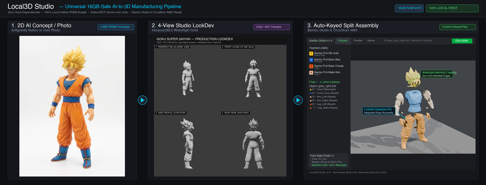

# 🚀 Local3D Studio — Universal 16GB-Safe AI-to-3D Manufacturing & MCP Server

[](LICENSE)
[](docs/MCP_GUIDE.md)
[](docs/ARCHITECTURE.md)
[](core/hardware_backend.py)
[](README_IT.md)

<p align="center">
  
</p>

<p align="center">
  <strong>Local Image-to-3MF/STL Manufacturing & Auto-Keyed Splitting for 3D Printing</strong><br>
  <em>100% Local • Consumer 16GB RAM/VRAM Safe • Zero Cloud Subscriptions • Native stdio MCP Server</em>
</p>

---

**Local3D Studio** is an open-source, production-grade 3D generative manufacturing suite and Model Context Protocol (MCP) server. It converts raw text prompts and 2D photos into high-definition, watertight 3D-printable figurines (`.stl`), modular keyed assemblies (`.3mf`), and game-ready digital assets (`.glb`).

Designed as a **100% local-first, zero-cloud alternative to platforms like Meshy AI and Tripo3D**, Local3D Studio executes entirely on consumer hardware within a strict **16 GB unified RAM/VRAM budget**—without requiring proprietary CUDA compilation flags or mandatory background daemon servers. By using the client AI's native visual generator (or user-provided photos) for 2D concepts, **100% of your 16 GB of RAM/VRAM is dedicated exclusively to 3D neural reconstruction (Hunyuan3D-2) and headless Blender manufacturing**.

> 📖 **Read in Italian / Leggi in Italiano**: [README_IT.md](README_IT.md)  
> 🏛️ **Architecture Deep-Dive**: [docs/ARCHITECTURE.md](docs/ARCHITECTURE.md)  
> 🔌 **MCP Client Setup Guide**: [docs/MCP_GUIDE.md](docs/MCP_GUIDE.md)  
> 🌐 **MCP Directories & Community**: [docs/SUBMISSIONS.md](docs/SUBMISSIONS.md)

---

## 🌟 Key Feature Highlights

### 1. Complete Meshy AI Open-Source Alternative (15 Native MCP Tools)
Local3D Studio provides a full local replacement for commercial 3D generation suites:
- **Direct Image-to-3D (`direct_image_to_3d`)**: 1-click transformation of any 2D concept or photo into a 3D mesh using `single_hero_34` (isometric props/weapons) or `multiview_turnaround` (full 360° characters).
- **Auto Split & Assembly Keying (`auto_split_model`)**: Automatically cuts models into keyed parts (Head, Torso, Arms, Legs) with 0.25mm assembly tolerances, manifold watertight capping, exploded `.glb` view, and native multi-color `.3mf` for Bambu Studio & OrcaSlicer AMS.
- **Humanoid Pose Guidance (`canonicalize_humanoid_pose`)**: Eliminates limb fusion (*mesh webbing*) by standardizing character inputs into **A-Pose (35°-45°)**, **T-Pose (90°)**, **Action Pose**, or **Natural Pose** with visual vector angle verification overlays.
- **AI Retopology Engine (`retopologize_mesh`)**: Generates clean topology via **Quadriflow 100% All-Quad** (ready for rigging/subdivision) or **Decimate Triangle Collapse** (exact polygon budget for game engines).
- **PBR Texture Baking (`bake_pbr_textures`)**: Bakes tangent-space Normal maps and Ambient Occlusion (AO) up to 4096px via headless Blender Cycles, exporting a production PBR `.glb`.

### 2. Pure In-Process MCP Execution (Zero Daemons Required)
Unlike systems that require running background FastAPI servers on `localhost:8000`, Local3D Studio's MCP server (`server.py`) communicates directly over **`stdio`**. Connect it to **Google Antigravity**, **Claude Desktop**, **Cursor**, or **Continue.dev** simply by pointing your client configuration to `server.py` or `run_mcp.sh`.

### 3. Universal Hardware Auto-Detection & Dynamic Tiering
Automatically inspects system capabilities (`psutil` + PyTorch device inspection) and selects one of 4 auto-scaling performance tiers:
- **Apple Silicon (macOS)**: Native `mps` backend with `torch.float16`.
- **AMD Radeon (Windows / Linux)**: Native AMD ROCm/HIP (`torch.version.hip`) or DirectML (`torch-directml`), completely free of CUDA lock-in.
- **NVIDIA GeForce / RTX**: Native `cuda` backend with SDPA attention.
- **Blender Discovery**: Autonomously locates Blender across macOS, Windows, and Linux.

| Tier | Target Hardware | 3D Engine Configuration | Remesh Resolution & Triangles |
|:---|:---|:---|:---|
| **`TIER 1 ECO`** | Mac 16GB / PC VRAM $\le 8$GB or RAM $\le 16$GB | Mini 320p (25 steps) | `0.0025m` (80,000 tris) |
| **`TIER 2 BALANCED`** | Mac 24-36GB / PC 10-12GB VRAM | Mini 320p (25 steps) | `0.0060m` (65,000 tris) |
| **`TIER 3 PRO 64GB`** | Mac $\ge 48$GB / PC $\ge 15$GB VRAM | **Full 1.1B** 384p (25 steps) | `0.0025m` (90,000 tris) |
| **`TIER 4 ULTRA`** | PC $\ge 22$GB VRAM / Mac $\ge 64$GB | **Full 1.1B** 512p (35 steps) | `0.0035m` (120,000 tris) |

### 4. Multi-View Turnaround Calibration (`tools/multiview_aligner.py`)
Eliminates rear-side hallucinations and occlusion:
- **Connected-Component Isolation**: Eliminates adjacent panel bleed-over using alpha mask segmentation (`scipy.ndimage`).
- **Y-Bounding-Box Lock**: Standardizes character height to 400px on a 512x512 canvas, locking the feet to $Z=0$ ($Y=456$) and crown to $Y=56$.
- **CLAHE Normal Enhancement**: Enhances fine surface relief in albedo textures before 3D reconstruction.

### 5. Production 3-Step Protocol & Hard Approval Gate
- **Prompt Compiler (`compile_3d_master_prompt`)**: Generates an ultra-detailed, photogrammetry-grade prompt in the **Meshy AI Single-Master 3/4** profile with strict anti-occlusion directives (A-pose, separated limbs, zero smoke, zero auras, zero pedestals).
- **Native Client AI 2D / User Photo (100% RAM Dedicated to 3D)**: Fully decouples 2D concept generation to the client AI assistant (e.g. Antigravity's native multimodal generator) or user-supplied reference photos. By eliminating local 2D diffusion pipelines, **100% of the 16 GB unified RAM/VRAM budget is dedicated to 3D neural reconstruction (Hunyuan3D-2) and headless Blender manufacturing**, completely avoiding system freezes and maximizing polygon fidelity.
- **Hard Approval Gate**: Execution strictly pauses after saving `output/<name>_concept.png`. The agent must display the concept and wait for explicit user confirmation before proceeding.
- **Direct 3D Reconstruction (`direct_image_to_3d`)**: Preprocesses the approved image with background removal (`rembg_engine.py`), CLAHE local contrast, and $Z=0$ ground lock, followed by isolated neural 3D reconstruction and headless Blender manufacturing.
- **Tempfile Hygiene**: Intermediate texture slices, masks, and raw neural meshes are kept inside `tempfile.TemporaryDirectory()`. Only the final `.stl`, `.glb`, `.3mf`, and `lookdev_sheet.png` are written to `output/`.

---

## 📂 Repository Structure

```text
Local3D-Studio/
├── .env.example                     # Reference environment configuration
├── .gitignore                       # Git ignore for virtualenvs, caches, outputs
├── LICENSE                          # MIT Open Source License
├── CONTRIBUTING.md                  # Contribution guidelines & code standards
├── README.md                        # English Master Documentation
├── README_IT.md                     # Italian Master Documentation
├── requirements.txt                 # Universal dependencies (zero C++ build flags)
├── setup_env.py                     # Universal installer & hardware bootstrapper
├── server.json                      # Official MCP Catalog Specification Manifest
├── run_mcp.sh / .bat                # In-process stdio MCP server launchers
├── update.sh / .bat                 # One-click automated updater scripts
├── start_worker.sh / .bat           # Optional Web Studio GUI launchers
├── server.py                        # Root MCP Server & Unified CLI (15 Native Tools)
├── worker_api.py                    # Optional FastAPI Web Studio & Three.js server
│
├── core/                            # Hardware abstraction, diagnostics & client layer
│   ├── __init__.py
│   ├── config.py                    # Environment variables & directory paths
│   ├── hardware_backend.py          # HardwareManager (MPS / ROCm / CUDA / 4 Tiers)
│   ├── diagnostics.py               # Local3D Doctor diagnostic & health inspection
│   ├── client_setup.py              # Automated multi-client setup & skill deployment
│   ├── updater.py                   # Automated GitHub release pull & dependency sync
│   ├── response_envelope.py         # Standardized MCP result and error contracts
│   ├── memory.py                    # VRAM/RAM garbage collector & cache cleaner
│   └── client.py                    # Unified REST client (optional LAN offload)
│
├── skills/                          # Bundled AI Agent Skills
│   └── local3d-studio/
│       ├── SKILL.md                 # Production 3-Step Protocol for Antigravity
│       └── references/              # Slicer & hardware tier reference guides
│
├── tools/                           # Modular Generative & Manufacturing Engines
│   ├── __init__.py
│   ├── prompt_enhancer.py           # Dynamic style router & Meshy AI prompt compiler
│   ├── pose_canonicalizer.py        # Humanoid Pose Guidance (A-Pose/T-Pose overlay)
│   ├── concept_engine.py            # Concept engine & fallback generator
│   ├── rembg_engine.py              # Pure Python background removal (u2net/ONNX)
│   ├── multiview_aligner.py         # Anti-bleed & Y-bounding-box lock calibration
│   ├── neural_3d_engine.py          # Hunyuan3D-2 shape generation (Mini & Full)
│   ├── blender_pipeline.py          # Blender headless remesh, LookDev, retopo, PBR
│   ├── model_splitter.py            # Auto Split, watertight capping, 3MF AMS export
│   └── pipeline_engine.py           # Master execution pipeline & state gate manager
│
├── frontend/                        # Web Studio Three.js GUI (Optional)
│   ├── __init__.py
│   └── web_viewer.py                # Three.js 3D viewport, wireframe inspect, telemetry
│
├── docs/                            # In-depth technical guides
│   ├── ARCHITECTURE.md              # Technical deep-dive & subsystem diagrams
│   └── MCP_GUIDE.md                 # Client setup (Antigravity, Claude, Cursor)
│
└── output/                          # Production deliverables (.stl, .glb, .3mf)
    └── .gitkeep
```

---

## ⚡ Quickstart Guide

### 1. Installation

```bash
git clone https://github.com/Jaco2308/Local3D_Studio.git
cd Local3D_Studio

# Run the universal installer (auto-detects Apple Silicon, AMD ROCm, NVIDIA CUDA)
python3 setup_env.py
```

`setup_env.py` automatically:
1. Detects your OS and GPU accelerator.
2. Installs the matching PyTorch wheels (`mps`, `rocm`, `cuda`, or `cpu`).
3. Installs requirements (`mcp`, `trimesh`, `rembg`, `scipy`, `psutil`, `fastapi`, `transformers`).
4. Autonomously locates your Blender installation.
5. Initializes your `.env` configuration file.

---

### 2. Universal `local3d` CLI Suite

Inspired by the REA architecture, Local3D Studio provides a system-wide unified CLI command (`local3d`):

```bash
# 1. Automated Health Diagnostics (Blender, PyTorch, Memory Tiers, MCP Client drift)
local3d doctor

# 2. Automated 1-Click Update (GitHub release sync, pip dependencies, skill refresh)
local3d update
# (or double-click update.bat on Windows / ./update.sh on macOS/Linux)

# 3. 1-Command Automated MCP Client Registration & Skill Deployment
local3d setup --client antigravity
local3d setup --client claude_desktop
local3d setup --client cursor

# 4. View Active Hardware Telemetry & Performance Tier
local3d status

# 5. Start Native Stdio MCP Server
local3d mcp
```

---

### 3. Connecting to Your MCP Client

Local3D Studio MCP Server runs **100% locally in-process over stdio**.

You can configure your client automatically with:
```bash
local3d setup --client antigravity
# Supported clients: antigravity, claude_desktop, cursor, vscode, gemini_cli
```

Or manually add Local3D Studio to your client's configuration file:

```json
{
  "mcpServers": {
    "local3d": {
      "command": "/absolute/path/to/Local3D-Studio/.venv/bin/python",
      "args": [
        "/absolute/path/to/Local3D-Studio/server.py"
      ],
      "env": {
        "PYTHONUNBUFFERED": "1",
        "PYTHONIOENCODING": "utf-8"
      }
    }
  }
}
```

*For complete configuration examples for Antigravity, Claude Desktop, Cursor, Continue.dev, and Windsurf, see [docs/MCP_GUIDE.md](docs/MCP_GUIDE.md).*

---

### 3. Optional: Interactive Three.js Web Studio GUI

If you want to view models in a web browser with drag & drop uploads, wireframe inspection, and real-time hardware telemetry:

```bash
# macOS / Linux:
./start_worker.sh

# Windows:
start_worker.bat
```
Then open `http://localhost:8000` in your web browser.

---

## 🛠️ MCP Tools Reference (Complete 15-Tool Suite)

| Tool Name | Arguments | Description |
|:---|:---|:---|
| `get_hardware_status` | *(none)* | Returns CPU, GPU backend (CUDA/ROCm/MPS), system RAM/VRAM, active Performance Tier (1-4), and Blender binary path. |
| `set_quality_preset` | `preset` | Sets active quality mode across the platform (`fast_draft`, `auto`, `ultra_production`). |
| `enhance_prompt_for_3d` | `prompt`, `mode`, `art_style`, `multiview`, `add_pedestal_base`, `humanoid_pose` | Expands raw prompts into photogrammetry-grade 3D prompts across 5 styles and standard pose angles. |
| `compile_3d_master_prompt` | `subject`, `art_style`, `key_details`, `add_pedestal_base`, `humanoid_pose`, `generation_strategy` | Compiles an ultra-detailed Meshy AI Single-Master 3/4 prompt for Antigravity native generation with anti-occlusion & zero-effects directives. |
| `align_multiview_concept` | `concept_path` | Crops quadrants, isolates main subject via connected components, locks Y-bounding-box, and enhances albedo. |
| `confirm_concept_and_build_3d` | `concept_path`, `output_filename`, `quality_preset`, `target_height_mm`, `add_pedestal`, `art_style`, `target_triangles`, `voxel_size`, `auto_split` | **Hard Approval Gate**: Invocable after user confirmation to execute 3D neural reconstruction and Blender pipeline. |
| `direct_image_to_3d` | `image_path`, `output_filename`, `quality_preset`, `generation_strategy`, `add_pedestal`, `target_height_mm`, `art_style`, `target_triangles`, `voxel_size`, `auto_split` | **Primary 3D Entry Point**: Converts approved 2D concept or user image to 3D with rembg, CLAHE, Hunyuan3D-2, and Blender manufacturing. |
| `retopologize_mesh` | `input_mesh_path`, `output_filename`, `mode`, `target_count` | **AI Retopology**: Converts dense sculpts into clean topology: Quadriflow all-quads (rigging) or fixed tri budget (games). |
| `bake_pbr_textures` | `input_mesh_path`, `output_filename`, `texture_resolution`, `bake_normal`, `bake_ao` | **PBR Texture Baker**: Computes tangent-space Normal maps and Ambient Occlusion (AO) via Blender Cycles, exporting PBR GLB. |
| `auto_split_model` | `input_mesh_path`, `output_filename`, `subject_category`, `add_connectors`, `connector_size_mm`, `exploded_distance_mm` | **Auto Split & Keying**: Bisects models into watertight parts with 0.25mm connector pegs/sockets, exploded GLB, and multi-color 3MF. |
| `canonicalize_humanoid_pose` | `image_path`, `target_pose`, `output_filename`, `art_style` | **Pose Guidance**: Eliminates armpit/crotch webbing by standardizing character inputs with visual vector angle overlay. |
| `image_to_high_detail_stl` | `image_path`, `output_filename`, `quality_preset`, `target_height_mm`, `target_triangles`, `voxel_size`, `add_pedestal`, `art_style` | Full end-to-end manufacturing pipeline with automatic Approval Gate validation and 3D print preparation. |
| `recalculate_in_ultra_production` | `output_filename` | 1-Click recalculation: Re-runs 3D generation on the latest concept using 100k polygon budget and dense remeshing. |
| `prepare_for_3d_print` | `input_mesh_path`, `output_filename`, `target_height_mm`, `target_triangles`, `voxel_size`, `smooth_iterations`, `add_pedestal` | Repairs existing meshes, normalizes scale to millimeters, forces Z=0 bed grounding, and guarantees watertightness. |
| `capture_multiview_sheet` | `mesh_path`, `output_filename` | Renders a 4-view studio LookDev sheet (Isometric 3/4 Hero, Front Close-Up, Profile, Rear View). |

---

## 🖨️ Bambu Lab / OrcaSlicer Multi-Color AMS Workflow

When using `auto_split_model`:
1. Local3D Studio splits your mesh into anatomical components (Head, Torso, Arms, Legs).
2. Generates individual watertight `.stl` files in `output/<name>_parts/` with 0.25mm keyed male/female pins.
3. Automatically writes a unified `.3mf` file with pastel vertex color assignments.
4. **Drag & drop** the generated `<name>_split.3mf` directly into **Bambu Studio** or **OrcaSlicer**:
   - The slicer will ask: *"Load these objects as a single object with multiple parts?"* -> Click **Yes**.
   - Assign filament slots (AMS Slot 1, 2, 3, 4) to each part in one click.
   - Slice and print without assembly glue or manual painting!

---

## 🌐 MCP Directories & Ecosystem

Local3D Studio is built to seamlessly integrate with any standard Model Context Protocol client:

### 1-Click Install via Smithery.ai
```bash
npx -y @smithery/cli install @Jaco2308/Local3D_Studio --client claude
```

### Official Registries & Communities
- **Model Context Protocol Servers**: Submitted to [modelcontextprotocol/servers](https://github.com/modelcontextprotocol/servers) community listings.
- **MCP Servers Directory**: Indexed on [mcpservers.org](https://mcpservers.org).
- **Smithery Registry**: Live on [smithery.ai](https://smithery.ai).
- **Reddit Communities**: Join discussions on [r/mcp](https://reddit.com/r/mcp), [r/BambuLab](https://reddit.com/r/BambuLab), and [r/3Dprinting](https://reddit.com/r/3Dprinting).
- Complete launch guides and directory PR templates: [docs/SUBMISSIONS.md](docs/SUBMISSIONS.md).

---

## 🤝 Contributing

We welcome community contributions, bug reports, and pull requests! Please read our [CONTRIBUTING.md](CONTRIBUTING.md) for architectural guidelines, manifold geometry invariants, and code formatting rules.

---

## 📄 License

Local3D Studio is released under the **MIT License**. See [LICENSE](LICENSE) for details. Free for personal, commercial, and research use.
