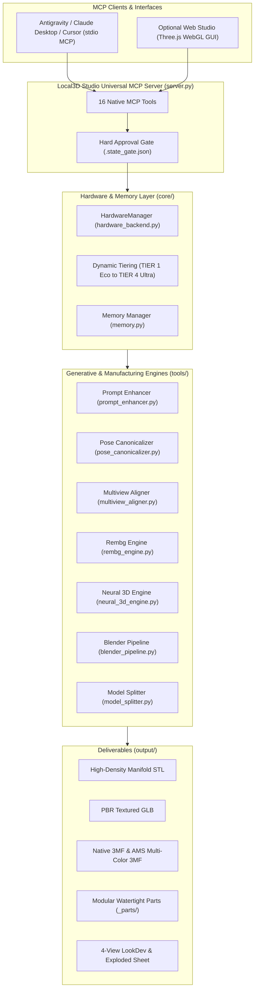

# Local3D Studio Architecture & Technical Deep-Dive

Local3D Studio is engineered from the ground up as a **100% local, cross-platform AI-to-3D generative manufacturing system** that eliminates reliance on closed cloud APIs (Meshy AI, Tripo3D) and complex localhost daemons.

---

## System Architecture Diagram

---

## 1. Hardware Abstraction & Auto-Scaling (`core/hardware_backend.py`)

Local3D Studio does not require hardcoded CUDA paths or specialized compiling. It inspects host capabilities on startup:

- **Apple Silicon (macOS)**: Native `mps` device with `torch.float16`.
- **AMD Radeon (Linux/Windows)**: Native ROCm HIP (`torch.version.hip`) or DirectML (`torch-directml`).
- **NVIDIA GeForce/RTX**: Native `cuda` with SDPA attention (`F.scaled_dot_product_attention`).
- **Blender Discovery**: Autonomously scans `/Applications/Blender.app`, `C:\Program Files\Blender Foundation\Blender *`, and `/usr/bin/blender`.

### Dynamic Hardware Tiers

| Tier | Profile Specification | 3D Engine Config | Blender Remesh Resolution | Target Triangles |
|:---|:---|:---|:---|:---|
| **`TIER 1 ECO`** | Mac 16GB / PC $\le 8$GB VRAM | Mini 320p (25 steps) | `0.0025m` | 80,000 tris |
| **`TIER 2 BALANCED`** | Mac 24-36GB / PC 10-12GB VRAM | Mini 320p (25 steps) | `0.0060m` | 65,000 tris |
| **`TIER 3 PRO 64GB`** | Mac $\ge 48$GB / PC $\ge 15$GB VRAM | Full 1.1B 384p (25 steps) | `0.0025m` | 90,000 tris |
| **`TIER 4 ULTRA`** | PC $\ge 22$GB VRAM / Mac $\ge 64$GB | Full 1.1B 512p (35 steps) | `0.0035m` | 120,000 tris |

---

## 2. Multi-View Turnaround Calibration (`tools/multiview_aligner.py`)

When generating complex characters, single-view neural generation suffers from rear-side hallucinations and blind-spot occlusion.
`MultiviewAligner` implements:
1. **Quadrant Separation**: Slices 3-panel model sheets into Front, Left Profile, and Back quadrants into `tempfile`.
2. **Connected Component Isolation**: Uses `scipy.ndimage.label` on alpha masks to keep only the primary figure and erase adjacent panel bleeding.
3. **Y-Bounding-Box Lock**: Scales and centers all views to an exact 400px height on 512x512 transparent canvases, anchoring the ground contact to $Y=456$ and top of the head to $Y=56$.
4. **CLAHE Normal Enhancement**: Applies Contrast Limited Adaptive Histogram Equalization to accentuate subtle relief crevices.

---

## 3. Auto Split & Assembly Keying (`tools/model_splitter.py`)

Decomposes complex 3D meshes into keyed modular parts for FDM/Resin 3D printing and multi-material AMS systems:
- **Hierarchical Bisection**:
  - Humanoid biped: Head/Neck, Torso Core, Left Arm, Right Arm, Left Leg, Right Leg.
  - Quadruped / Beast: Skull, Mane/Neck, Torso Ribcage, 4 Limbs, Tail.
  - Prop / Weapon: Blade Tip, Crossguard, Grip, Pommel.
- **Watertight Manifold Capping**:
  - Executes `bpy.ops.mesh.bisect` in headless Blender.
  - Capped with `bpy.ops.mesh.fill_holes(sides=0)`.
  - Normal consistency recalculated (`bpy.ops.mesh.normals_make_consistent(inside=False)`).
  - Micro-sliver filter (`faces < 20`) via `trimesh` guarantees 0 boundary edges.
- **0.25mm Keying Clearance**:
  - Automatically unions male registration pegs on outer parts.
  - Carves matching female sockets with a $0.25\text{ mm}$ radial expansion tolerance for smooth snap-fit assembly.
- **Multi-Object 3MF**:
  - Combines all parts into a single `.3mf` package with pastel vertex colors for Bambu Studio and OrcaSlicer.

---

## 4. Humanoid Pose Guidance (`tools/pose_canonicalizer.py`)

Prevents limb-to-body fusion (*mesh webbing*) by standardizing character inputs into canonical poses:
- `a_pose`: Arms angled downward at 35°-45° with wide open air space at armpits and inner thighs.
- `t_pose`: Arms extended horizontally at 90°, straight elbows, palms down.
- `action_pose`: Heroic dynamic combat stance with separated limbs.
- `natural`: Relaxed upright standing posture.
- Includes angle verification overlay with guideline vectors and telemetry labels.

---

## 5. Retopology & PBR Texture Baking

- **Retopology (`tools/blender_pipeline.py`)**:
  - `quad`: Quadriflow 100% All-Quad manifold mesh generation for rigging and subdivision surfaces.
  - `tri`: Decimate collapse to an exact polygon budget for real-time game engines.
- **PBR Baking (`tools/blender_pipeline.py`)**:
  - Smart UV projection with `angle_limit=66.0` and `island_margin=0.015`.
  - Tangent-space Normal map baking in Blender Cycles.
  - Ambient Occlusion (AO) map baking at 2048px/4096px.
  - Native PBR material graph binding and GLB export.
