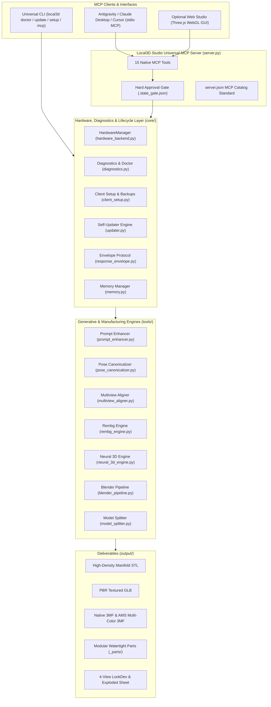

# Local3D Studio Architecture & Technical Deep-Dive

Local3D Studio is engineered from the ground up as a **100% local, cross-platform AI-to-3D generative manufacturing system** that eliminates reliance on closed cloud APIs (Meshy AI, Tripo3D) and complex localhost daemons.

---

## System Architecture Diagram



---

## 1. Hardware Abstraction & Auto-Scaling (`core/hardware_backend.py`)

Local3D Studio does not require hardcoded CUDA paths or specialized compiling. It inspects host capabilities on startup:

- **Apple Silicon (macOS)**: Native `mps` device with `torch.float16`.
- **AMD Radeon (Linux/Windows)**: Native ROCm HIP (`torch.version.hip`) or DirectML (`torch-directml`).
- **NVIDIA GeForce/RTX**: Native `cuda` with SDPA attention (`F.scaled_dot_product_attention`).
- **Blender Discovery**: Autonomously scans `/Applications/Blender.app`, `C:\Program Files\Blender Foundation\Blender *`, and `/usr/bin/blender`.

### Dynamic Hardware Tiers

| Tier | Profile Specification | 3D Engine Config | Blender Remesh Resolution | Target Triangles |
|:---|:---|:---|:---|:---|
| **`TIER 1 ECO`** | Mac 16GB / PC $\le 8$GB VRAM | Mini 320p (25 steps) | `0.0025m` | 80,000 tris |
| **`TIER 2 BALANCED`** | Mac 24-36GB / PC 10-12GB VRAM | Mini 320p (25 steps) | `0.0060m` | 65,000 tris |
| **`TIER 3 PRO 64GB`** | Mac $\ge 48$GB / PC $\ge 15$GB VRAM | Full 1.1B 384p (25 steps) | `0.0025m` | 90,000 tris |
| **`TIER 4 ULTRA`** | PC $\ge 22$GB VRAM / Mac $\ge 64$GB | Full 1.1B 512p (35 steps) | `0.0035m` | 120,000 tris |

---

## 2. Multi-View Turnaround Calibration (`tools/multiview_aligner.py`)

When generating complex characters, single-view neural generation suffers from rear-side hallucinations and blind-spot occlusion.
`MultiviewAligner` implements:
1. **Quadrant Separation**: Slices 3-panel model sheets into Front, Left Profile, and Back quadrants into `tempfile`.
2. **Connected Component Isolation**: Uses `scipy.ndimage.label` on alpha masks to keep only the primary figure and erase adjacent panel bleeding.
3. **Y-Bounding-Box Lock**: Scales and centers all views to an exact 400px height on 512x512 transparent canvases, anchoring the ground contact to $Y=456$ and top of the head to $Y=56$.
4. **CLAHE Normal Enhancement**: Applies Contrast Limited Adaptive Histogram Equalization to accentuate subtle relief crevices.

---

## 3. Auto Split & Assembly Keying (`tools/model_splitter.py`)

Decomposes complex 3D meshes into keyed modular parts for FDM/Resin 3D printing and multi-material AMS systems:
- **Hierarchical Bisection**:
  - Humanoid biped: Head/Neck, Torso Core, Left Arm, Right Arm, Left Leg, Right Leg.
  - Quadruped / Beast: Skull, Mane/Neck, Torso Ribcage, 4 Limbs, Tail.
  - Prop / Weapon: Blade Tip, Crossguard, Grip, Pommel.
- **Watertight Manifold Capping**:
  - Executes `bpy.ops.mesh.bisect` in headless Blender.
  - Capped with `bpy.ops.mesh.fill_holes(sides=0)`.
  - Normal consistency recalculated (`bpy.ops.mesh.normals_make_consistent(inside=False)`).
  - Micro-sliver filter (`faces < 20`) via `trimesh` guarantees 0 boundary edges.
- **0.25mm Keying Clearance**:
  - Automatically unions male registration pegs on outer parts.
  - Carves matching female sockets with a $0.25\text{ mm}$ radial expansion tolerance for smooth snap-fit assembly.
- **Multi-Object 3MF**:
  - Combines all parts into a single `.3mf` package with pastel vertex colors for Bambu Studio and OrcaSlicer.

---

## 4. Humanoid Pose Guidance (`tools/pose_canonicalizer.py`)

Prevents limb-to-body fusion (*mesh webbing*) by standardizing character inputs into canonical poses:
- `a_pose`: Arms angled downward at 35°-45° with wide open air space at armpits and inner thighs.
- `t_pose`: Arms extended horizontally at 90°, straight elbows, palms down.
- `action_pose`: Heroic dynamic combat stance with separated limbs.
- `natural`: Relaxed upright standing posture.
- Includes angle verification overlay with guideline vectors and telemetry labels.

---

## 5. Retopology & PBR Texture Baking

- **Retopology (`tools/blender_pipeline.py`)**:
  - `quad`: Quadriflow 100% All-Quad manifold mesh generation for rigging and subdivision surfaces.
  - `tri`: Decimate collapse to an exact polygon budget for real-time game engines.
- **PBR Baking (`tools/blender_pipeline.py`)**:
  - Smart UV projection with `angle_limit=66.0` and `island_margin=0.015`.
  - Tangent-space Normal map baking in Blender Cycles.
  - Ambient Occlusion (AO) map baking at 2048px/4096px.
  - Native PBR material graph binding and GLB export.
 
---
 
## 6. Production 3-Step Architecture & 16GB Zero-Freeze Strategy
 
To guarantee zero system freezes and prevent heavy memory swap on 16GB unified RAM machines (such as Apple Silicon MacBooks), Local3D Studio decouples the generation lifecycle into three deterministic steps:
 
1. **Prompt Compilation (`compile_3d_master_prompt`)**:
   - Synthesizes user descriptions into an ultra-detailed, photogrammetry-grade prompt formatted in the **Meshy AI Single-Master 3/4** profile.
   - Enforces strict anti-occlusion directives (A-pose, separated limbs, elevated 35° isometric angle) and categorically bans non-physical artifacts (energy auras, ki blasts, smoke, clouds, circular base pedestals).
 
2. **Concept 2D Generation & Hard Approval Gate**:
   - High-resolution 2D concepts are generated directly via the client AI assistant (e.g. Antigravity's native multimodal generator) or provided by the user.
   - This eliminates the heavy RAM footprint of loading local 2D diffusion pipelines into unified memory, dedicating 100% of the 16GB RAM budget to 3D neural reconstruction (Hunyuan3D-2) and headless Blender manufacturing.
   - The generated concept is saved to `output/<name>_concept.png` and presented to the user. Execution strictly pauses until explicit user approval is granted.
 
3. **Neural 3D Reconstruction & Manufacturing (`direct_image_to_3d`)**:
   - Once approved, the image is automatically preprocessed via `rembg_engine.py` (with connected-component filtering to strip loose artifacts), CLAHE local contrast enhancement, and bounding-box grounding to $Z=0$ ($Y=456$).
   - Neural 3D reconstruction runs in an isolated environment (`PYTORCH_MPS_HIGH_WATERMARK_RATIO=0.0` with aggressive memory purges before and after inference).
   - Headless Blender (`bpy`) processes the raw mesh with `separate(type='LOOSE')` to isolate the primary shell, performs non-destructive polygon decimation, and exports production deliverables (`.stl`, `.glb`, `.3mf`, and `lookdev_sheet.png`).

---

## 7. Deep Diagnostic Engine & System Doctor (`core/diagnostics.py`)

Local3D Studio includes an automated health diagnostic system invoked via `local3d doctor` or programmatically via MCP:

- **Host Runtime & Isolation**: Validates Python $\ge 3.10$, virtual environment activation, and UTF-8 console encoding (preventing Windows `cp1252` encoding exceptions).
- **Hardware Telemetry & Acceleration**:
  - Physical RAM and available memory headroom inspection.
  - CPU model identification (utilizing Windows Registry `HARDWARE\DESCRIPTION\System\CentralProcessor\0`, macOS `sysctl`, or Linux `/proc/cpuinfo` to avoid deprecated WMI utilities).
  - Neural accelerator probing: CUDA (with compute capability), DirectML (`torch-directml`), Apple Silicon MPS, or ROCm HIP.
- **Blender Headless Verification**:
  - Resolves active `BLENDER_PATH` from `.env` or auto-scans system directories.
  - Spawns a background subprocess executing `blender --background --version` to ensure non-blocking headless execution.
- **MCP Client Configuration Drift**:
  - Inspects known client configuration locations (Google Antigravity, Claude Desktop, Cursor, VS Code).
  - Reports whether the `local3d` server is registered, verifies python binary paths, and flags missing environment flags (`PYTHONUNBUFFERED=1`).

---

## 8. Multi-Client Atomic Auto-Setup (`core/client_setup.py`)

To eliminate error-prone manual JSON editing across diverse operating systems and clients, `Local3D Studio` provides atomic client configuration:

- **Safe JSON Patching**: Reads existing client settings, verifies JSON integrity, creates a timestamped recovery backup (`.local3d.backup`), and updates the `mcpServers.local3d` stanza without disturbing other server entries.
- **Antigravity Skill Provisioning**: Automatically deploys the `local3d-studio` agent skill (`SKILL.md` and reference documentation) into `~/.gemini/config/skills/local3d-studio/`, enabling agent awareness of 3D manufacturing protocols.
- **Cross-Platform CLI Shimming**:
  - Generates `local3d.cmd` on Windows (targeting user `PATH` directories like `AppData\Local\Python\bin` and `.gemini\antigravity\bin`).
  - Generates executable POSIX shell wrappers on macOS and Linux.

---

## 9. Automated Lifecycle & Self-Updating Engine (`core/updater.py`)

Modeled after production reverse-engineering and developer tools (such as REA), `local3d update` provides one-click lifecycle management:

- **Git Remote Synchronization**: Queries `git fetch` and evaluates ahead/behind revision deltas against `origin/main`.
- **Dependency Drift Resolution**: Automatically runs `pip install -r requirements.txt` within the dedicated virtual environment upon detecting remote changes.
- **Skill Synchronization**: Refreshes global AI agent skill definitions to match any prompt engineering or API improvements in the repository.
- **Post-Update Self-Check**: Automatically triggers `local3d doctor` following updates to ensure all runtime dependencies and system bridges remain operational.
- **One-Click Native Wrappers**: Packaged with `update.bat` (Windows) and `update.sh` (macOS/Linux) for immediate desktop execution without opening a shell.

---

## 10. Standardized Envelope Contracts & Catalog Specification

### Normalized Response Envelope (`core/response_envelope.py`)
All MCP tool calls and internal procedures communicate through a strict, normalized contract:

```json
{
  "success": true,
  "code": "OK",
  "data": { ... },
  "remediation": null,
  "metadata": {
    "timestamp": "2026-10-16T18:30:00Z",
    "version": "1.0.0"
  }
}
```

In the event of an operational failure (e.g. missing Blender executable, insufficient VRAM, or unapproved 2D concept), the server returns `success: false` accompanied by actionable `remediation` directives:
- Pinpoints the root cause.
- Supplies the exact command or setting to fix it (e.g., `local3d setup`, setting `BLENDER_PATH`, or calling `confirm_concept_and_build_3d`).

### MCP Catalog Specification (`server.json`)
Conforms to the official Model Context Protocol server catalog schema (2025-12-11):
- Declares standard `stdio` transport parameters.
- Lists server capabilities, author metadata, environment configurations, and documentation references.


