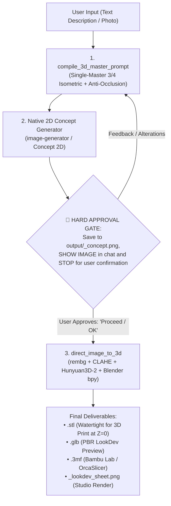

# Local3D Studio — AI 3D Manufacturing Pipeline

Use Local3D Studio to generate production-ready 3D models (watertight STL, PBR GLB, multi-color 3MF) from user descriptions or reference photos, executed 100% locally with zero cloud subscription dependencies.

## 🏛️ The 3-Step Production Protocol

---

## 📋 Strict Operational Rules

### Step 1: Prompt Master Compilation (`compile_3d_master_prompt`)
Before generating any 2D art, compile the prompt:
- **Framing**: Single full-body subject in 3/4 isometric perspective (35° elevation), showing front and side contours.
- **Total Anti-Occlusion**: Arms detached in A-pose (35°-45°), legs separated with clear negative space, wings lifted, tail base visible.
- **Purity**: Pure white `#ffffff` background, zero smoke, zero magic auras, zero pedestal bases (unless explicitly requested).

### Step 2: Native Concept Generation & Hard Approval Gate
1. Invoke the native `image-generator` with the compiled prompt.
2. Save the resulting image to `output/<subject>_concept.png`.
3. **MANDATORY STOP**: Present the concept image to the user in the chat message and HALT.
   - ⚠️ **NEVER** call 3D reconstruction tools in the same turn as 2D generation.
   - Wait for the user's explicit confirmation ("Proceed", "Looks good", "Yes").

### Step 3: Neural 3D Reconstruction & Manufacturing (`direct_image_to_3d`)
Once approved (or if the user supplied an image directly):
1. Call `direct_image_to_3d(image_path=...)`.
2. Automatic background removal + CLAHE contrast enhancement + ground lock at $Z=0$.
3. Headless Blender execution: loose fragment purging, voxel remesh, mesh decimation, manifold verification, and multi-angle studio rendering.
4. If the object exceeds print volume or requires assembly, use `auto_split_model(mesh_path=..., num_parts=2)` for keyed joinery.

---

## 📐 Geometric Conventions & 3D Print Rules

- **Coordinate System**:
  - Blender: **Z is UP**, X is RIGHT, Y is FORWARD.
  - Three.js: **Y is UP**, X is RIGHT, Z is FORWARD.
- **Build Plate Alignment**: The contact base is locked at $Z = 0$ in Blender ($Y = 0$ in Three.js).
- **Watertight Manifold**: Every output mesh is guaranteed watertight (2-manifold), with zero self-intersections or inverted normals.
- **Slicer Formats**: Generates `.stl` and `.3mf` compatible with Bambu Studio, OrcaSlicer, PrusaSlicer, and Anycubic.
